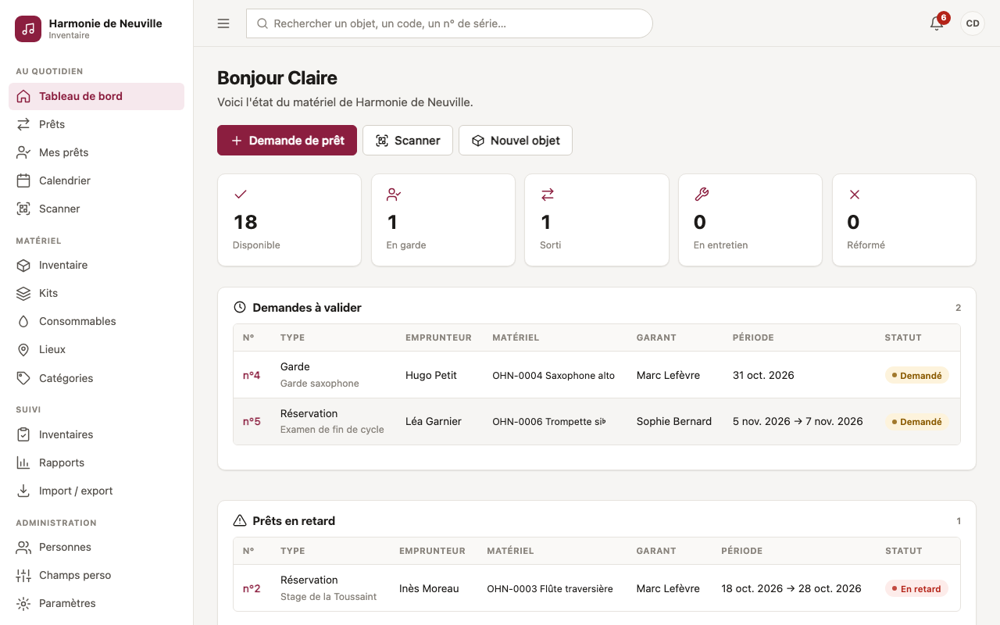
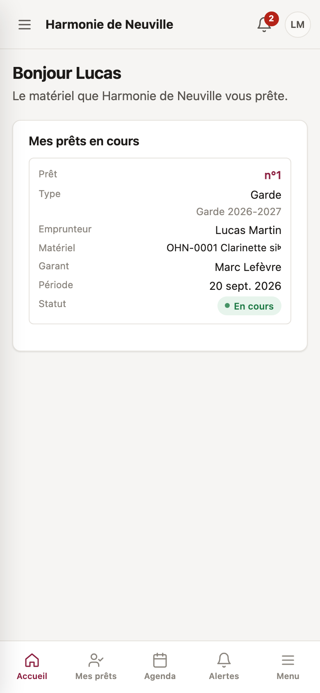
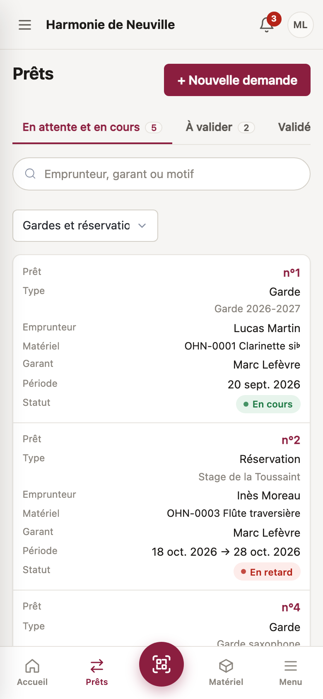

# Pupitre — inventaire d'association musicale

Application web de gestion des instruments et du matériel d'une association musicale : inventaire, prêts aux musiciens et aux élèves, kits, consommables, QR codes, inventaires physiques, rappels et rapports.

Inspirée de [Shelf.nu](https://www.shelf.nu/), elle est **entièrement en français**. Elle ajoute ce dont une harmonie a besoin : les profs **demandent** les prêts et s'en **portent garants**, un administrateur les **valide**.



<p align="center">
  
  &nbsp;&nbsp;
  
</p>

## Fonctionnalités

### Inventaire

- **Fiches objets** : photos, notes, état, statut, marque, modèle, n° de série, prix d'achat et valeur estimée, **champs personnalisés** par catégorie, **tags**, **lieux en arborescence**, historique complet de chaque modification.
- **Documents joints** aux objets et aux kits : factures, devis, notices, garanties, certificats, assurances (PDF, images, Word, Excel…).
- **Entretiens** (avec coût et prochaine échéance) et **rappels** programmés sur un objet.
- **Recherche sans accents** (« flute » trouve « Flûte »), filtres, actions groupées (déplacer, ajouter un tag, étiquettes), « Enregistrer et créer un autre ».
- **Kits** (sono, batterie…) prêtés d'un bloc, et **consommables** (anches, pupitres…) suivis en quantité, consommés ou retournables, avec alerte de stock bas.
- **Corbeille** : un objet ou un kit supprimé se restaure pendant 30 jours.

### Prêts

- Deux sortes : les **gardes** (un instrument confié pour l'année) et les **réservations** (une période précise, par exemple un concert).
- Le circuit : **demande** par un prof qui s'en porte **garant**, **validation** par un admin, **remise**, puis **retour**, éventuellement partiel, avec caution. Les doubles réservations sont impossibles, même quand deux admins valident en même temps.
- Un **emprunteur** connecté peut demander du matériel pour lui-même : son garant accepte d'abord, puis un admin valide.
- **« Rien oublié ? »** : en fin de concert, on scanne ce qu'on a en main et l'appli montre ce qui manque, à plusieurs en même temps.
- **Liste du matériel à imprimer** pour chaque prêt, avec cases départ / retour et signatures.

### QR codes et terrain

- **QR code** sur chaque objet et chaque kit, **planches d'étiquettes A4** en trois formats. On scanne avec l'appareil photo du téléphone, la page « Scanner » ou une douchette.
- **Page publique** du QR code : sans compte, on peut **signaler un problème** ou dire **« J'ai trouvé cet objet »**. Les messages arrivent dans le menu **Signalements**.
- **Inventaire physique** : on scanne ce qui est présent, et un rapport liste ce qui est trouvé, manquant, prêté ou inattendu.

### Suivi

- **Tableau de bord** à la carte : chacun choisit les blocs affichés et leur ordre.
- **Calendrier** des prêts et entretiens, avec un flux iCal personnel pour Google Agenda, Outlook ou Apple Calendrier.
- **Notifications et rappels automatiques** : retards, retours, sorties, entretiens, stocks bas, demandes en attente. Dans l'appli, et par email si un serveur SMTP est configuré. Les textes des emails se modifient depuis les paramètres.
- **Rapports** (valeur du parc pour l'assurance et l'AG, utilisation, retours, gardes, coûts d'entretien, objets inactifs) et **import / export** CSV ou Excel.

### Comptes et administration

- **Comptes** : invitations et mot de passe oublié par email, espace « Mon compte » (profil, photo, appareils connectés), fiche détaillée de chaque personne, archivage, fusion de doublons et actions groupées.
- **Rôles sur mesure** et droits modifiables (voir [Rôles](#rôles)).
- **Connexion OIDC** facultative (Authentik, Keycloak, Google, Microsoft…), avec rôles déduits des groupes.
- **Personnalisation** : nom, logo et couleur de l'association ; thème clair ou sombre, taille du texte et page d'accueil au choix de chacun.
- **État de l'installation** (`/sante`) : base, migrations, disque, rappels et emails vérifiés en un coup d'œil.
- Interface **adaptée au téléphone**, installable comme une application (PWA).

La liste complète, domaine par domaine, est dans [Liste des fonctionnalités](docs/fonctionnalites.md). Ce qui a changé version après version est dans le [journal des versions](CHANGELOG.md).

## Rôles

| | Admin | Prof | Emprunteur |
|---|:---:|:---:|:---:|
| Consulter et modifier l'inventaire, notes, entretiens, stock | ✅ | ✅ | — |
| Demander un prêt (et s'en porter garant) | ✅ | ✅ | — |
| Demander du matériel pour soi (avec l'accord d'un garant) | ✅ | — | ✅ |
| Traiter les signalements, documents joints | ✅ | ✅ | — |
| **Valider ou refuser** un prêt | ✅ | — | — |
| Remettre ou récupérer le matériel | ✅ | ✅ si garant | — |
| Supprimer ou réformer, corbeille, comptes, rôles, import, paramètres, clôture d'inventaire | ✅ | — | — |
| Mes prêts, calendrier, notifications | ✅ | ✅ | ✅ |

Ce sont les droits **par défaut** : les droits du Prof et de l'Emprunteur se modifient dans l'écran **Rôles** (admin), qui permet aussi de créer des rôles sur mesure (« Régisseur », « Secrétariat »…). L'Admin garde toujours tous les droits. Le détail des droits est dans le [guide d'utilisation](docs/guide-utilisateur.md#qui-peut-faire-quoi). Côté code, toutes les règles sont centralisées dans [app/permissions.py](app/permissions.py).

## Démarrage rapide

Avec Docker, derrière un reverse proxy HTTPS :

```sh
git clone <url-du-depot> inventaire && cd inventaire
cp .env.example .env
python3 -c "import secrets; print(secrets.token_hex(32))"   # à coller dans SECRET_KEY
# éditer .env : SECRET_KEY, BASE_URL, ASSO_NAME…

mkdir -p data && sudo chown 1000:1000 data
docker compose up -d --build
docker compose exec app flask seed           # catégories et lieu par défaut
docker compose exec app flask create-admin   # premier administrateur
```

L'appli écoute sur `127.0.0.1:8000` (`BIND_ADDR` pour un proxy sur une autre machine). Toutes les étapes, dont le reverse proxy, les sauvegardes et les mises à jour, sont dans le [guide d'installation](docs/installation.md).

Pour essayer en local avec des données fictives, voir [Développement](docs/developpement.md#essayer-avec-des-données-de-démo).

## Documentation

| Document | Pour qui | Contenu |
|---|---|---|
| [Liste des fonctionnalités](docs/fonctionnalites.md) | Tout le monde | Tout ce que fait l'appli, domaine par domaine |
| [Guide d'utilisation](docs/guide-utilisateur.md) | Admins, profs, emprunteurs | Toutes les fonctionnalités, écran par écran |
| [Installation et exploitation](docs/installation.md) | Personne qui héberge l'appli | Docker, reverse proxy, sauvegarde, mise à jour, emails |
| [Configuration](docs/configuration.md) | Personne qui héberge l'appli | Toutes les variables d'environnement |
| [Connexion OIDC avec Authentik](docs/oidc-authentik.md) | Personne qui héberge l'appli | SSO pas à pas, test en local, dépannage |
| [Architecture](docs/architecture.md) | Développeurs | Structure du code, modèle de données, choix techniques |
| [Développement](docs/developpement.md) | Développeurs | Environnement, tests, migrations, conventions |
| [Contribuer](CONTRIBUTING.md) | Contributeurs | Signaler un bug, proposer une modification |
| [Sécurité](SECURITY.md) | Tout le monde | Signaler une faille |
| [Journal des versions](CHANGELOG.md) | Tout le monde | Ce qui a changé |

## Technologies

Python 3.12+, Flask, SQLAlchemy, SQLite, Jinja et [HTMX](https://htmx.org/), [Pico CSS](https://picocss.com/), Gunicorn, Docker. Il n'y a ni étape de build JavaScript ni service externe obligatoire : tout tient dans un conteneur et un dossier `data/`.

Les tests (pytest, Playwright, Hypothesis) couvrent les permissions de chaque rôle sur toutes les routes, les règles métier, la sécurité et des parcours complets dans un vrai navigateur.

## Licence

Aucune licence n'est encore choisie : en l'état, le code est visible, mais sa réutilisation n'est pas autorisée sans accord.
