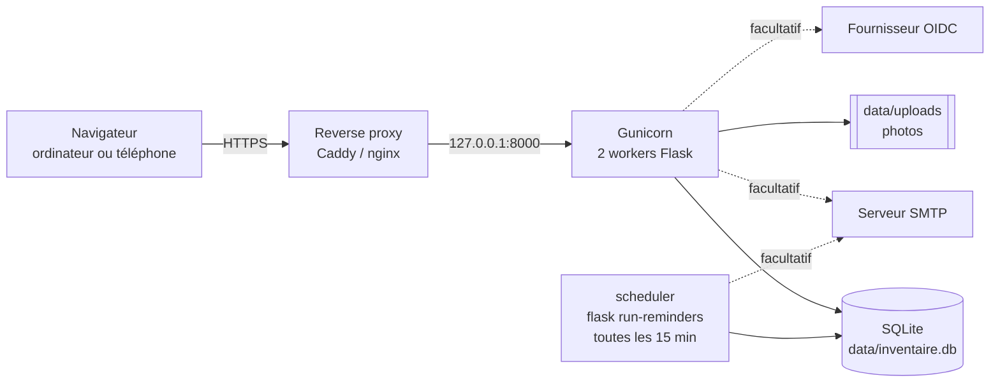
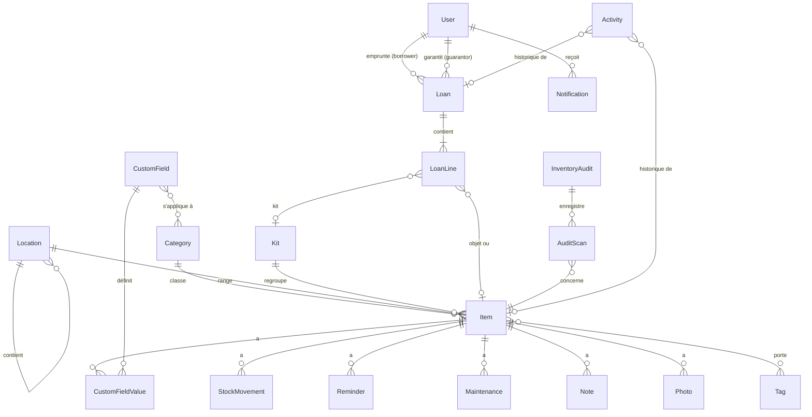
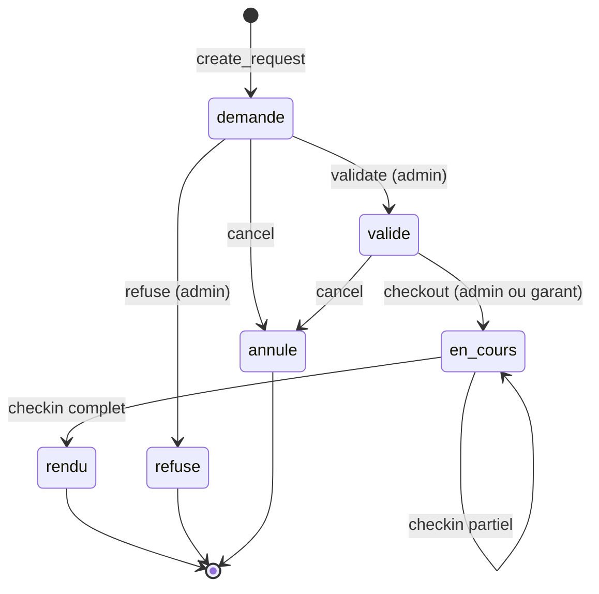

# Architecture

Ce document explique comment le code est organisé et pourquoi. Il s'adresse aux personnes qui veulent le comprendre ou le modifier. Pour installer l'environnement de développement et lancer les tests, voir [Développement](developpement.md).

## Sommaire

- [Vue d'ensemble](#vue-densemble)
- [Organisation du code](#organisation-du-code)
- [Cheminement d'une requête](#cheminement-dune-requête)
- [Modèle de données](#modèle-de-données)
- [Permissions](#permissions)
- [Prêts : disponibilité et cycle de vie](#prêts--disponibilité-et-cycle-de-vie)
- [Choix techniques](#choix-techniques)
- [Interface](#interface)
- [Sécurité](#sécurité)
- [Tâches périodiques et notifications](#tâches-périodiques-et-notifications)

## Vue d'ensemble

Une application **Flask** monolithique, rendue côté serveur, avec très peu de JavaScript :



| Couche | Technologie |
|---|---|
| Serveur web | Flask 3, Gunicorn |
| Données | SQLAlchemy 2, SQLite (mode WAL), Alembic via Flask-Migrate |
| Authentification | Flask-Login (sessions), Authlib (OIDC, facultatif) |
| Formulaires | Flask-WTF / WTForms, protection CSRF |
| Interface | Templates Jinja, [HTMX](https://htmx.org/), [Pico CSS](https://picocss.com/) plus une feuille de style maison |
| Bibliothèques embarquées | html5-qrcode (scan caméra), FullCalendar (calendrier) |
| Fichiers | Pillow (photos), qrcode (QR en SVG), openpyxl (Excel), icalendar (flux iCal) |
| Tests | pytest, Playwright (navigateur), Hypothesis (propriétés) |

Il n'y a **aucune étape de build** front-end : les bibliothèques JavaScript sont copiées dans `app/static/vendor/`, ce qui fait aussi tourner l'appli sans CDN.

## Organisation du code

```
├── app/
│   ├── __init__.py          fabrique create_app() : configuration, extensions, blueprints, en-têtes de sécurité
│   ├── config.py            configuration lue dans l'environnement (Config, TestConfig)
│   ├── extensions.py        db, migrate, csrf, login_manager ; fonction SQL fold() ; transactions SQLite
│   ├── models.py            tous les modèles SQLAlchemy et leurs constantes (statuts, rôles…)
│   ├── permissions.py       qui peut faire quoi : can(), @require, ensure()
│   ├── forms.py             formulaires partagés
│   ├── filters.py           filtres Jinja (dates, montants…)
│   ├── cli.py               commandes flask : create-admin, seed, run-reminders
│   ├── services/            règles métier, sans dépendance aux requêtes HTTP
│   │   ├── loans.py           disponibilité, conflits, transitions des prêts
│   │   ├── stock.py           mouvements de stock
│   │   ├── audits.py          inventaire physique
│   │   ├── items.py           recherche, filtres, champs personnalisés
│   │   ├── transfer.py        import / export CSV et Excel
│   │   ├── reports.py         calculs des rapports
│   │   ├── reminders.py       rappels périodiques
│   │   ├── notify.py          notifications dans l'appli
│   │   ├── mailer.py          envoi des emails
│   │   ├── activity.py        journal d'activité (historique)
│   │   ├── qr.py              QR codes et résolution d'un scan
│   │   ├── photos.py          traitement des images
│   │   └── oidc.py            client OIDC, rattachement des comptes, rôles par groupes
│   ├── blueprints/          routes HTTP, une par domaine (items, loans, kits, audits…)
│   ├── templates/           Jinja ; un dossier par blueprint, fragments HTMX préfixés par _
│   │   └── partials/          macros communes (champs de formulaire, icônes, lignes de prêts)
│   └── static/
│       ├── css/app.css        la feuille de style de l'appli
│       ├── js/                petits scripts : scan, formulaire de prêt, calendrier, service worker
│       ├── vendor/            htmx, Pico, html5-qrcode, FullCalendar
│       └── icons/             icônes de la PWA
├── migrations/              migrations Alembic de la base
├── tests/                   pytest (unitaires, routes, propriétés, sécurité, e2e)
├── scripts/                 données de démo, captures d'écran de la doc
├── docs/                    documentation
├── wsgi.py                  point d'entrée (charge .env puis create_app())
├── Dockerfile, docker-compose.yml, entrypoint.sh
└── requirements.txt, requirements-dev.txt
```

**La règle de partage** :

- les **blueprints** lisent la requête, vérifient les droits, appellent un service et rendent un template ;
- les **services** portent les règles métier et lèvent des exceptions au message destiné à l'utilisateur (`LoanError`, `StockError`, `AuditError`, `TransferError`, `OidcRefused`) ;
- les **services ne font pas de commit** : c'est la route qui valide la transaction (ou l'annule, comme pour l'essai d'import).

## Cheminement d'une requête

Exemple : un admin valide un prêt.

1. `POST /prets/42/valider`, avec le jeton CSRF du formulaire.
2. Comme la requête est un POST, SQLAlchemy ouvre la transaction avec `BEGIN IMMEDIATE` ([extensions.py](../app/extensions.py)) : la requête prend le verrou d'écriture de SQLite dès le début.
3. Le décorateur `@require("loan.validate")` vérifie la connexion et le droit ([permissions.py](../app/permissions.py)).
4. La route appelle `loans.validate(loan, current_user)` ([services/loans.py](../app/services/loans.py)). Le service :
   - revérifie la disponibilité ;
   - change le statut ;
   - écrit dans le journal d'activité ;
   - crée les notifications.
5. La route fait `db.session.commit()`, envoie les emails en attente sans bloquer, puis redirige. Pour une requête HTMX, elle renvoie seulement le fragment de page à remplacer.

## Modèle de données



Les points importants :

- **`User`** représente à la fois les comptes et les simples fiches emprunteur. `active` décide si la personne peut se connecter. `oidc_sub` et `role_from_oidc` servent à la connexion OIDC.
- **`Item`** a deux modes de suivi (`tracking`) :
  - `individuel` : un objet physique, avec `quantity` = 1 ;
  - `quantite` : un lot, avec `quantity` = stock. Le mode de consommation (`consumption_mode`) distingue alors le `consomme` (distribué) du `retournable` (prêté puis rendu).
- **`Item.status`** suit la disponibilité. Il est changé automatiquement par les prêts (`en garde`, `sorti`) et à la main pour `disponible` ou `en entretien`. `réformé` sort l'objet du parc.
- **`Loan`** a des **`LoanLine`**, chacune pointant vers un objet (avec une quantité) ou vers un kit entier. `returned_at` sur la ligne permet les retours partiels.
- **`Activity`** est le journal : chaque action importante y écrit un message, et éventuellement les changements champ par champ (`changes`, en JSON). C'est l'historique affiché sur les fiches.
- **`Notification.dedup_key`**, unique, empêche les rappels périodiques de créer des doublons.
- **`qr_token`** : un jeton aléatoire par objet et par kit. Le QR code ne contient pas l'identifiant interne, qui serait devinable.

Les contraintes `CHECK` (rôle, statut, quantité ≥ 0) protègent la base même en cas de bug applicatif.

## Permissions

Tout passe par **une seule fonction**, `can(user, action, obj=None)`, dans [app/permissions.py](../app/permissions.py) :

- `ROLE_PERMISSIONS` liste les droits qui ne dépendent que du rôle (`"loan.validate": {ADMIN}`…) ;
- quelques droits dépendent de l'objet : un prof ne remet un prêt que s'il en est garant, ne supprime que ses notes, etc. ;
- une action inconnue lève une erreur, pour qu'une faute de frappe ne donne jamais un accès par défaut.

Trois façons de l'utiliser :

```python
@require("item.edit")                 # sur une route : connexion obligatoire + droit, sinon 403
ensure("loan.checkout", loan)         # dans une vue, une fois l'objet chargé
   # dans un template, pour masquer un bouton
```

Les tests vérifient chaque droit, et un test de balayage (`tests/test_sweep.py`) visite **toutes les routes avec chaque rôle**. Une nouvelle route sans protection fait échouer la suite.

## Prêts : disponibilité et cycle de vie



Les règles, dans [services/loans.py](../app/services/loans.py) :

- Seuls les statuts **validé** et **en cours** bloquent le matériel (`LoanStatus.BLOCKING`). Une demande ne réserve rien. Elle produit seulement un avertissement si une autre demande vise le même matériel.
- Les périodes sont des intervalles **semi-ouverts**, `[début, fin[` : un prêt qui finit à 18 h et un autre qui commence à 18 h ne se chevauchent pas. Une fin absente (garde) signifie « sans limite ».
- Un prêt **en cours et en retard** bloque jusqu'au retour effectif : sa fin effective devient « sans limite ».
- Un **kit** couvre tous ses objets. Un objet d'un kit ne peut pas être demandé seul.
- Pour un objet **en quantité retournable**, la capacité est `quantity`. Un **consommable** ne bloque pas de période : seul le stock compte.
- La disponibilité est **revérifiée à chaque transition** (validation, remise, prolongation), pas seulement à la demande.

Les tests de propriétés (`tests/test_properties.py`, Hypothesis) génèrent des suites aléatoires de demandes, validations, remises et retours. Ils vérifient qu'il n'y a jamais deux prêts bloquants sur le même objet, jamais de quantité dépassée et jamais de stock négatif.

## Choix techniques

**SQLite plutôt qu'un serveur de base de données.** Pour une association, un fichier unique simplifie tout : rien à administrer, sauvegarde par simple copie cohérente, un seul conteneur. Le volume (quelques milliers d'objets, quelques dizaines d'utilisateurs) est très loin des limites de SQLite. Le mode **WAL** permet des lectures concurrentes pendant une écriture.

**`BEGIN IMMEDIATE` pour les requêtes d'écriture.** Avec deux workers Gunicorn, deux admins pourraient valider en même temps deux prêts en conflit : chacun lirait l'état « libre », puis écrirait. Toute requête POST, PUT, PATCH ou DELETE prend donc le verrou d'écriture dès le début de sa transaction ([extensions.py](../app/extensions.py)). Les écritures sont sérialisées, et la seconde validation voit la première. Les lectures restent concurrentes. La gestion implicite des transactions de `pysqlite` est désactivée au profit de celle de SQLAlchemy (recette officielle), car elle gère mal les `SAVEPOINT`.

**Recherche sans accents avec `fold()`.** SQLite ne sait comparer sans casse que l'ASCII. Une fonction Python `fold()` (minuscules, accents retirés) est enregistrée dans SQLite à chaque connexion : `fold(name) LIKE fold('%flute%')` trouve « Flûte ». C'est l'une des raisons pour lesquelles seul SQLite est pris en charge.

**Heure locale plutôt qu'UTC.** Les horodatages utilisent `datetime.now()`, en heure locale du serveur (`TZ`), et non `CURRENT_TIMESTAMP`, qui est en UTC. L'appli ne sert qu'un fuseau : stocker l'heure locale évite les conversions et les décalages d'une heure aux changements d'heure, dans l'affichage comme dans les calculs de retard.

**Migrations sous SQLite.** SQLite ne sait pas modifier une contrainte : Alembic doit alors recréer la table (mode « batch »). Comme les clés étrangères sont actives, recréer une table référencée, comme `user` ou `item`, échoue dès qu'il y a des données. Les migrations privilégient donc les opérations natives (ajout de colonne, index unique plutôt que contrainte unique, suppression de colonne). `tests/test_migrations.py` joue les migrations sur une base remplie. Voir [Développement › Migrations](developpement.md#migrations).

**Rendu serveur et HTMX plutôt qu'une SPA.** Les pages sont des templates Jinja. HTMX remplace des fragments (ajout d'une note, recherche de matériel, résultat d'un scan) sans recharger la page. Les actions restent de vrais formulaires HTML : la plupart des routes acceptent aussi une soumission classique. Il y a moins de code, aucun build, et le même contrôle des droits partout.

## Interface

- **Templates** : un dossier par blueprint dans `app/templates/`. Les fragments renvoyés aux requêtes HTMX commencent par `_` (`_scan_result.html`…). La route détecte HTMX avec l'en-tête `HX-Request`.
- **Styles** : Pico CSS fournit la base (formulaires, typographie) ; `app/static/css/app.css` définit l'identité, la mise en page et les composants. Le thème suit le mode clair ou sombre du système.
- **Mobile** : sous 960 px, la barre latérale devient un tiroir et une barre d'onglets apparaît en bas. Les tableaux deviennent des cartes.
- **PWA** : un manifeste (`/manifest.webmanifest`) et un service worker (`/sw.js`, servi à la racine pour couvrir toute l'appli) permettent l'installation sur l'écran d'accueil. Le service worker ne met en cache que `/static/` : les données passent toujours par le réseau.
- **JavaScript maison** : quelques petits fichiers dans `app/static/js/` (scan caméra, formulaire de prêt, calendrier, scan d'inventaire). Aucun framework.

## Sécurité

| Mesure | Où |
|---|---|
| Protection CSRF sur tous les formulaires ; les requêtes HTMX envoient le jeton dans l'en-tête `X-CSRFToken` | Flask-WTF, `csrf` dans [extensions.py](../app/extensions.py), `hx-headers` dans `base.html` |
| Mots de passe hachés (scrypt, via Werkzeug) | `User.set_password` |
| Limitation des tentatives de connexion : 8 échecs en 15 min, par email et par IP | [blueprints/auth.py](../app/blueprints/auth.py) |
| Temps de réponse identique pour un compte existant ou non (hash factice) | idem |
| Mot de passe provisoire à changer obligatoirement à la première connexion | `force_password_change` |
| Redirections après connexion limitées aux chemins locaux | `safe_next` |
| Cookies `HttpOnly`, `SameSite=Lax`, `Secure` en HTTPS | [config.py](../app/config.py) |
| En-têtes `X-Content-Type-Options`, `X-Frame-Options: DENY`, `Referrer-Policy`, `Permissions-Policy` ; `no-store` sur les pages qui affichent un mot de passe | `security_headers` dans [app/__init__.py](../app/__init__.py) |
| Photos décodées puis réencodées en JPEG ; refus des « bombes de décompression » | [services/photos.py](../app/services/photos.py) |
| Photos servies uniquement aux personnes connectées, avec noms de fichiers aléatoires | `items.uploaded_file` |
| QR codes et flux iCal fondés sur des jetons aléatoires ; lien iCal révocable | `qr_token`, `ical_token` |
| OIDC : PKCE, `state`, `nonce`, signature de l'`id_token` vérifiée, liaison par email seulement si l'email est vérifié | [services/oidc.py](../app/services/oidc.py) |
| Refus de démarrer sans `SECRET_KEY` en production | `create_app` |
| Conteneur exécuté sans droits root, port lié à `127.0.0.1` | `Dockerfile`, `docker-compose.yml` |

`tests/test_security.py` couvre ces points : redirections ouvertes, limitation des tentatives, en-têtes, images piégées, accès aux fichiers…

## Tâches périodiques et notifications

- `notify(users, message, link, dedup_key)` crée une notification par destinataire. Une `dedup_key` déjà utilisée est ignorée, ce qui rend les rappels **idempotents** : relancer `run-reminders` ne crée pas de doublons. La clé inclut la période voulue, par exemple `overdue:<id>:<date>` pour une relance par jour.
- `flask run-reminders` ([services/reminders.py](../app/services/reminders.py)) calcule tous les rappels, puis envoie les emails en attente. Le service `scheduler` le lance toutes les 15 minutes.
- Après une action utilisateur, `deliver_quietly()` tente d'envoyer les emails tout de suite, sans jamais faire échouer la requête si le serveur SMTP est indisponible. Le prochain passage du scheduler réessaiera.
