# Guide d'utilisation

Ce guide décrit l'inventaire écran par écran. Il s'adresse aux trois rôles : administrateurs, profs et emprunteurs. Chaque section indique qui peut faire quoi.

## Sommaire

- [Se connecter](#se-connecter)
- [Mon compte](#mon-compte)
- [Les trois rôles](#les-trois-rôles)
- [Le tableau de bord](#le-tableau-de-bord)
- [L'inventaire](#linventaire)
  - [Fiche objet](#fiche-objet)
  - [Créer et modifier un objet](#créer-et-modifier-un-objet)
  - [Statuts et états](#statuts-et-états)
  - [Photos, documents, notes, entretiens, rappels](#photos-documents-notes-entretiens-rappels)
  - [Réformer ou supprimer](#réformer-ou-supprimer)
  - [La corbeille](#la-corbeille)
  - [Actions groupées](#actions-groupées)
- [Lieux, catégories, tags et champs personnalisés](#lieux-catégories-tags-et-champs-personnalisés)
- [Kits](#kits)
- [Consommables et stock](#consommables-et-stock)
- [Les prêts](#les-prêts)
  - [Gardes et réservations](#gardes-et-réservations)
  - [Le cycle d'un prêt](#le-cycle-dun-prêt)
  - [Demander un prêt](#demander-un-prêt)
  - [Valider ou refuser](#valider-ou-refuser)
  - [Remettre le matériel](#remettre-le-matériel)
  - [Vérifier qu'on n'a rien oublié](#vérifier-quon-na-rien-oublié)
  - [Liste du matériel à imprimer](#liste-du-matériel-à-imprimer)
  - [Récupérer le matériel](#récupérer-le-matériel)
  - [Prolonger, raccourcir, annuler](#prolonger-raccourcir-annuler)
- [QR codes, étiquettes et scanner](#qr-codes-étiquettes-et-scanner)
- [Signalements](#signalements)
- [Inventaire physique](#inventaire-physique)
- [Calendrier et abonnement iCal](#calendrier-et-abonnement-ical)
- [Notifications et rappels automatiques](#notifications-et-rappels-automatiques)
- [Rapports](#rapports)
- [Import et export](#import-et-export)
- [Personnes et comptes](#personnes-et-comptes)
- [Paramètres](#paramètres)
- [Installer l'appli sur un téléphone](#installer-lappli-sur-un-téléphone)
- [Qui peut faire quoi](#qui-peut-faire-quoi)
- [Questions fréquentes](#questions-fréquentes)

## Se connecter

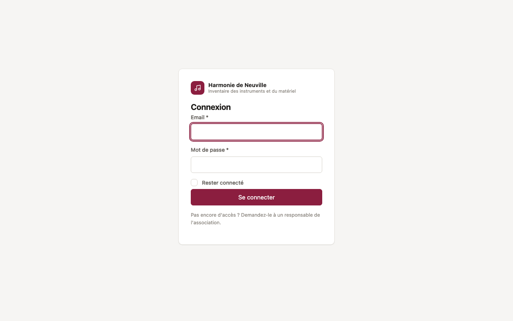

- **Avec email et mot de passe.** Le compte est créé par un administrateur. Vous recevez une **invitation** par email (ou l'admin vous transmet le lien) : le lien, valable 7 jours, permet de choisir votre mot de passe, d'au moins 8 caractères. Si l'admin vous a plutôt donné un **mot de passe provisoire**, l'appli demande d'en choisir un nouveau à la première connexion. Vous pourrez le changer plus tard dans [Mon compte](#mon-compte).
- **Avec le compte de l'association** : si le bouton « Se connecter avec … » est affiché, la connexion passe par le fournisseur d'identité de l'association (Authentik, Google…). Voir [la doc OIDC](oidc-authentik.md#comptes-et-rôles) pour le rattachement des comptes.
- Après 8 échecs en 15 minutes, la connexion est bloquée quelques minutes pour cet email ou cette adresse.
- **Rester connecté** garde la session ouverte sur cet appareil. À éviter sur un ordinateur partagé.

**Mot de passe oublié ?** Le lien sous le formulaire de connexion envoie un email de réinitialisation (valable 1 heure, utilisable une seule fois). Choisir un nouveau mot de passe déconnecte vos autres appareils. Si l'envoi d'emails n'est pas configuré, demandez à un administrateur un nouveau lien ou un mot de passe provisoire.

## Mon compte

Cliquez sur votre nom (en bas du menu) ou sur votre avatar, puis **Mon compte** :

- **Profil** : prénom, nom et téléphone ;
- **Photo de profil** : recadrée en carré, elle remplace vos initiales dans le menu et apparaît dans la liste des personnes et sur votre fiche. Elle n'est visible que des personnes connectées à l'appli ;
- **Changer d'adresse email** : un lien de confirmation part vers la nouvelle adresse, et l'ancienne reste active tant qu'il n'a pas été suivi. L'ancienne adresse reçoit ensuite un message de prévenance. Votre mot de passe actuel est demandé ;
- **Changer mon mot de passe** ;
- **Mes appareils connectés** : navigateur, adresse IP, date de connexion et dernière activité de chaque appareil. Déconnectez un appareil que vous ne reconnaissez pas, ou tous vos autres appareils d'un coup.

## Les trois rôles

- **Administrateur** : gère tout, et il est le seul à **valider** les prêts, à supprimer, à gérer les comptes et les paramètres.
- **Professeur** : gère l'inventaire au quotidien (objets, notes, entretiens, stock). Il **demande** les prêts pour ses élèves et s'en porte **garant**, puis remet et récupère le matériel des prêts dont il est garant.
- **Emprunteur** : voit uniquement **ses** prêts, son calendrier et ses notifications. Il peut **demander du matériel pour lui-même** en choisissant un garant, qui doit accepter (voir [Demande d'un emprunteur](#demande-dun-emprunteur)). Un emprunteur peut aussi être une simple **fiche** sans accès à l'appli : un élève à qui on prête un instrument, mais qui ne se connecte pas.

Ce sont les rôles de base. Un admin peut modifier leurs droits et créer d'autres rôles : voir [Rôles sur mesure](#rôles-sur-mesure).

Le tableau complet est en fin de guide : [Qui peut faire quoi](#qui-peut-faire-quoi).

## Le tableau de bord

**Admins et profs** voient :

- des raccourcis : **Demande de prêt**, **Scanner**, **Nouvel objet** ;
- le nombre d'objets par statut (disponible, en garde, sorti, en entretien, réformé) ;
- les **demandes à valider** (admins), les **prêts en retard**, les **sorties des 7 prochains jours** ;
- les **entretiens à prévoir** et les **stocks bas**.

**Les emprunteurs** voient leurs prêts en cours.


La recherche en haut de page cherche dans tout l'inventaire : code, désignation, marque, numéro de série… sans tenir compte des accents ni des majuscules.

## L'inventaire

**Menu Inventaire** (admins et profs).

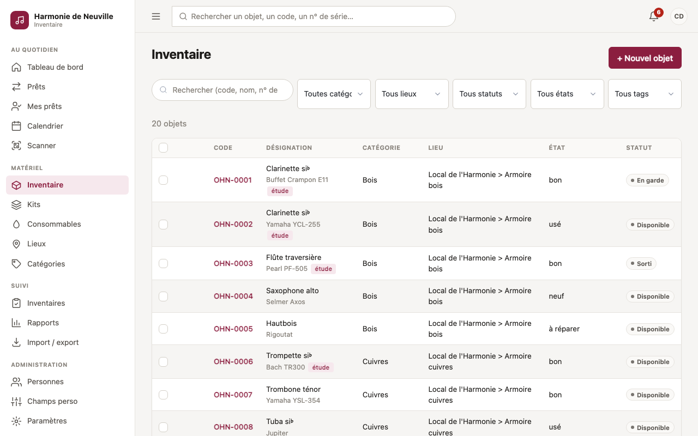

La liste se filtre par **catégorie**, **lieu** (sous-lieux compris), **statut**, **état** et **tag**, et se trie en cliquant sur les en-têtes. La recherche porte sur le code, la désignation, la marque, le modèle, le numéro de série et les champs personnalisés.

### Fiche objet

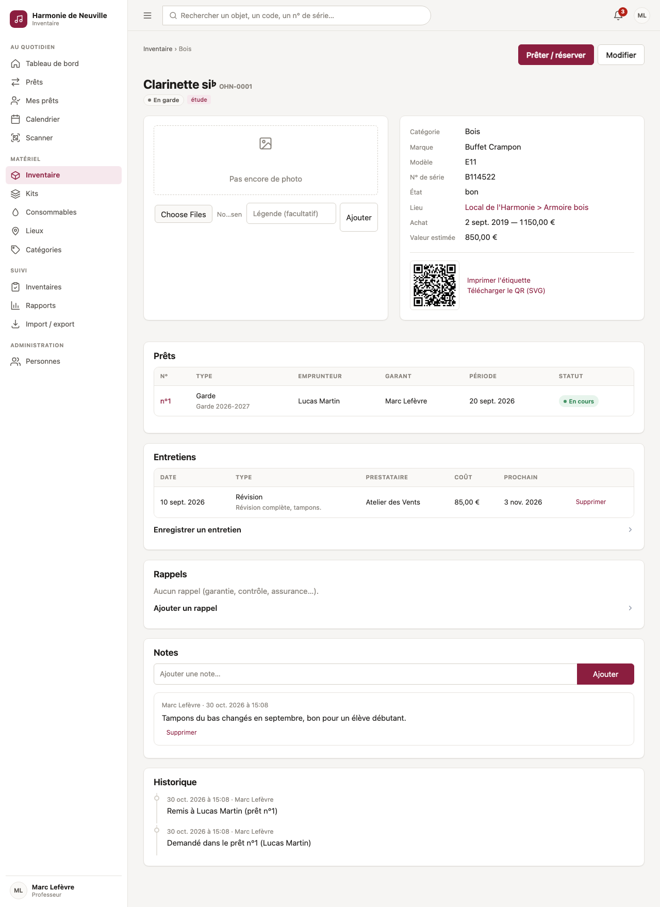

La fiche regroupe :

- les **informations** : catégorie, marque, modèle, numéro de série, état, lieu, date et prix d'achat, valeur estimée, champs personnalisés ;
- le **QR code**, avec les liens pour imprimer l'étiquette ou télécharger le QR en SVG ;
- les **photos** ;
- les **prêts** qui concernent l'objet ;
- les **entretiens**, les **rappels** et les **notes** ;
- l'**historique** : création, modifications champ par champ, prêts, remises, retours, déplacements, inventaires.

Le bouton **Prêter / réserver** ouvre une demande de prêt avec l'objet déjà ajouté.

### Créer et modifier un objet

**Nouvel objet** (admins et profs). Les champs principaux :

- **Code** : attribué automatiquement (`INV-0001`, `INV-0002`…). Le préfixe se règle dans la configuration.
- **Désignation** et **catégorie** : obligatoires. La catégorie détermine les champs personnalisés proposés.
- **Suivi** :
  - **individuel**, le cas par défaut : un objet = une fiche (une clarinette, une enceinte) ;
  - **en quantité** : une fiche pour un lot (40 pupitres, des boîtes d'anches). Voir [Consommables et stock](#consommables-et-stock).
- **Tags** : mots-clés libres séparés par des virgules (« étude, concert »). Ils sont créés à la volée.
- **Valeur estimée** : utilisée par le rapport de valeur du parc (assurance, AG). À défaut, c'est le prix d'achat qui compte.

Chaque modification est enregistrée dans l'historique, avec l'ancienne et la nouvelle valeur.

### Statuts et états

Le **statut** indique où en est l'objet :

| Statut | Signification | Qui le change |
|---|---|---|
| Disponible | Au local, prêtable | Automatique au retour, ou à la main |
| En garde | Confié pour une garde | Automatique à la remise |
| Sorti | Parti pour une réservation | Automatique à la remise |
| En entretien | Chez le réparateur, non prêtable | À la main, ou en enregistrant un entretien |
| Réformé | Retiré du parc (vendu, perdu, hors service) | Bouton « Réformer » (admin) |

L'**état** décrit l'objet physique : neuf, bon, usé, à réparer, HS. Il peut être mis à jour au retour d'un prêt.

Un objet **en entretien** ou **réformé** ne peut pas être prêté.

### Photos, documents, notes, entretiens, rappels

- **Documents** : section « Documents » des fiches objet et kit. Joignez une facture, un devis, une notice, une garantie, un certificat ou une attestation d'assurance : PDF, image, Word, Excel, OpenDocument ou texte, 16 Mo au plus. Choisissez le type et, si vous voulez, un titre. Les PDF et images s'ouvrent dans le navigateur, les autres fichiers se téléchargent. Un fichier dont le contenu ne correspond pas à son extension est refusé. Les documents ont leurs propres droits : par défaut, les profs les voient et en ajoutent, les emprunteurs non. Ils suivent l'objet à la corbeille et sont effacés avec lui.
- **Photos** : choisissez une image, éventuellement depuis l'appareil photo du téléphone, avec une légende facultative. Les images sont redressées et réduites automatiquement.
- **Notes** : remarques libres, datées et signées. Un prof peut supprimer ses propres notes, un admin toutes.
- **Entretiens** : date, type (révision, réparation, nettoyage…), prestataire, coût, description et **date du prochain entretien**. On peut aussi mettre l'objet « en entretien » ou le rendre disponible au même moment. La date du prochain entretien alimente les rappels et le tableau de bord. Les coûts alimentent le rapport « Coûts d'entretien ».
- **Rappels** : une date et un message (fin de garantie, contrôle, assurance…), avec les destinataires de votre choix. Sans destinataire, ce sont les admins qui le reçoivent.

### Réformer ou supprimer

Réservé aux **admins**.

- **Réformer** retire l'objet du parc sans perdre son historique. C'est l'action normale pour un instrument vendu, perdu ou hors d'usage. Un objet actuellement prêté ne peut pas être réformé. **Réintégrer** le remet en service.
- **Supprimer** met l'objet à la **corbeille**. C'est possible seulement si l'objet n'a **jamais été prêté** (sinon, réformez-le) et s'il n'est pas sorti en ce moment.

### La corbeille

Bouton **Corbeille** en haut de l'inventaire et de la page Kits (admins). Un objet ou un kit supprimé y reste **30 jours** :

- tant qu'il est dans la corbeille, il n'apparaît nulle part (inventaire, recherche, lieux, rapports, exports, inventaires physiques) et son QR code ne mène plus à rien. Son code reste réservé ;
- **Restaurer** le remet exactement comme avant, avec ses photos, notes et entretiens. Un kit restauré récupère ses objets, sauf ceux qui ont rejoint un autre kit entre-temps ;
- **Supprimer définitivement** l'efface tout de suite, avec ses photos et son historique ;
- au bout de 30 jours, il est effacé automatiquement au passage des rappels ;
- **Vider la corbeille** efface tout d'un coup. Seul un administrateur peut le faire.

Les pointages d'un inventaire physique ne sont pas conservés pour un objet mis à la corbeille. Une catégorie ne peut pas être supprimée tant qu'un objet de la corbeille en fait partie.

### Actions groupées

Cochez des objets dans la liste pour :

- les **déplacer** vers un lieu ;
- leur **ajouter des tags** ;
- **imprimer leurs étiquettes**.

## Lieux, catégories, tags et champs personnalisés

- **Lieux** (créés et modifiés par les admins et les profs, supprimés par les admins) : arborescence libre, par exemple « Local de répétition > Armoire bois ». Filtrer sur un lieu inclut ses sous-lieux. Un lieu ne peut être supprimé que s'il est vide (ni objet ni sous-lieu).
- **Catégories** (créées et modifiées par les admins et les profs, supprimées par les admins) : nom, couleur et type. Le type est **instrument**, **matériel** ou **consommable**. Un objet d'une catégorie « consommable » est suivi en quantité.
- **Tags** : libres, créés en tapant leur nom sur une fiche.
- **Champs personnalisés** (admins, menu **Champs perso**) : des champs en plus des champs standard, limités ou non à certaines catégories. Exemples : « Diapason » pour les bois, « Taille » pour les tenues. Les types possibles sont texte, nombre, date, oui / non et liste de choix. Un champ peut être obligatoire. Il apparaît sur la fiche, dans le formulaire et dans les exports.

## Kits

**Menu Kits** (admins et profs). Un kit est un ensemble d'objets prêtés **d'un bloc**, comme une sono ou une batterie.

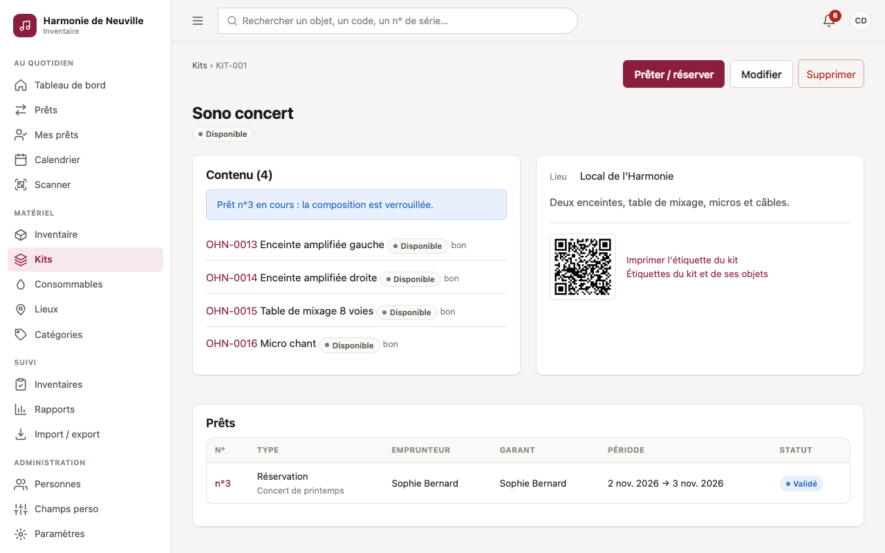

- Créez le kit, puis ajoutez-y des objets existants. Un objet appartient à un seul kit à la fois.
- Un objet d'un kit ne peut pas être prêté seul : on prête le kit complet.
- La composition ne peut pas changer pendant un prêt en cours.
- Un kit a son propre QR code. Le scanner pendant un inventaire physique compte tous ses objets.
- Les consommables ne peuvent pas entrer dans un kit.
- Seuls les admins suppriment un kit, et seulement s'il n'a jamais été prêté : sinon, retirez-en les objets si besoin. Le kit part à la [corbeille](#la-corbeille) et ses objets restent dans l'inventaire.

## Consommables et stock

**Menu Consommables** (admins et profs).

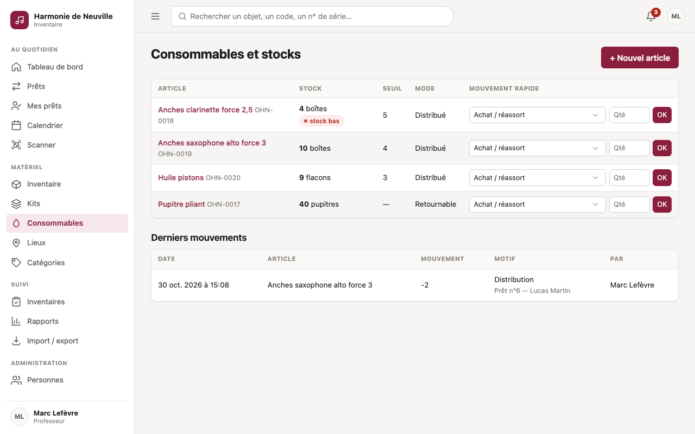

Les objets **suivis en quantité** se répartissent en deux modes :

- **Consommé** (anches, huile, cordes) : ce qui est distribué ne revient pas. Le stock baisse à la remise.
- **Retournable** (pupitres, câbles) : prêté en quantité, puis rendu. On peut prêter 25 pupitres sur 40 ; les 15 autres restent disponibles sur la même période.

**Mouvements de stock** (bouton sur la fiche ou dans la liste) :

| Motif | Effet |
|---|---|
| Achat / réassort | Ajoute la quantité |
| Retour en stock | Ajoute la quantité |
| Distribution | Retire la quantité |
| Perte / casse | Retire la quantité |
| Correction d'inventaire | Remplace par la quantité réellement comptée |

Le stock ne peut jamais devenir négatif. Avec un **seuil de stock bas**, les admins reçoivent une alerte quand on l'atteint, puis une relance par semaine. L'objet apparaît aussi dans « Stocks bas » sur le tableau de bord.

## Les prêts

**Menu Prêts** (admins et profs), **Mes prêts** (tout le monde).

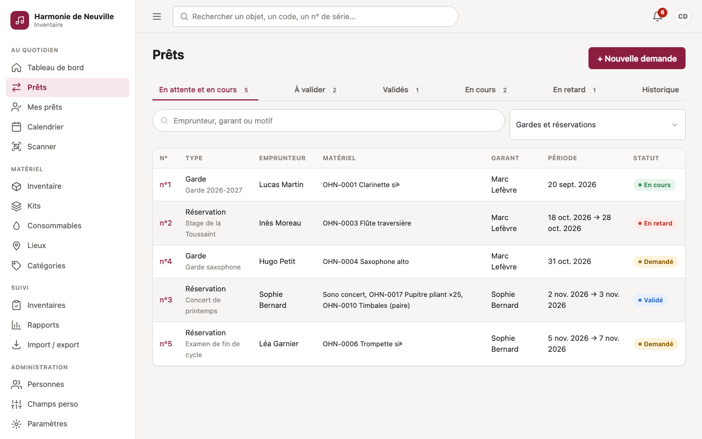

### Gardes et réservations

- **Garde** : longue durée, sans date de fin obligatoire. Exemple : un instrument confié à un élève pour l'année.
- **Réservation** : une période précise, avec début et fin obligatoires. Exemple : la sono pour le concert de printemps.

### Le cycle d'un prêt

```
            ┌──────────┐ validation ┌────────┐  remise  ┌──────────┐  retour complet  ┌───────┐
 demande ──▶│ Demandé  │───────────▶│ Validé │─────────▶│ En cours │─────────────────▶│ Rendu │
            └──────────┘   (admin)  └────────┘          └──────────┘                  └───────┘
               │    │                   │                  │   ▲
               │    └─ refus ──▶ Refusé │                  └───┘ retour partiel
               └──── annulation ────────┴──▶ Annulé
```

- Une **demande ne bloque rien** : deux demandes peuvent viser le même instrument. La personne qui demande en est avertie, et l'admin tranche à la validation.
- Un prêt **validé** ou **en cours** bloque le matériel sur sa période. Une deuxième validation sur la même période est refusée, avec le nom du prêt en conflit.
- Un prêt en cours dont la date de fin est dépassée continue de bloquer le matériel jusqu'au retour effectif. Il apparaît « En retard ».

### Demander un prêt

**Nouvelle demande** (admins et profs).

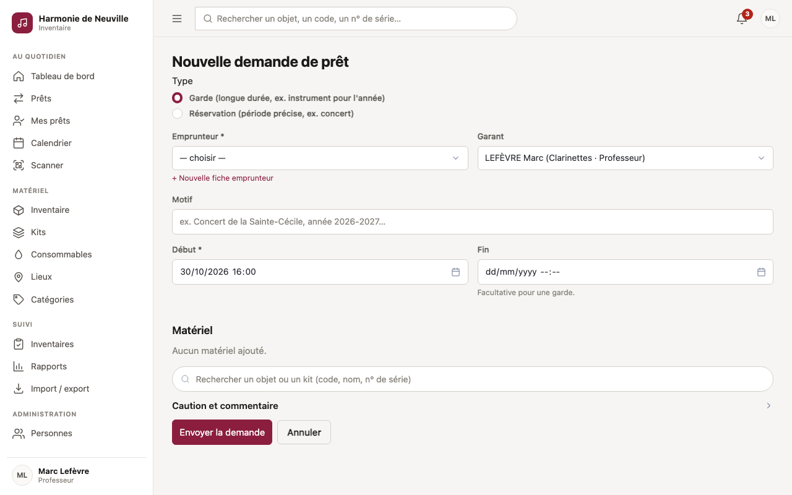

1. **Type** : garde ou réservation.
2. **Emprunteur** : la personne qui part avec le matériel. Si elle n'existe pas encore, **+ Nouvelle fiche emprunteur** la crée sans quitter la demande.
3. **Garant** : un prof qui répond du matériel. Un prof est automatiquement garant de ses propres demandes ; un admin choisit le garant, ou aucun.
4. **Motif** (facultatif), **début**, **fin** (obligatoire pour une réservation).
5. **Matériel** : cherchez par code, nom ou numéro de série, puis ajoutez des objets, des kits, ou une quantité pour les objets suivis en quantité. La disponibilité est vérifiée au fur et à mesure.
6. **Caution et commentaire** (facultatif) : montant de la caution, informations utiles à l'admin.

Les admins sont notifiés de la nouvelle demande.

### Demande d'un emprunteur

Un emprunteur connecté peut demander du matériel pour lui-même : bouton **Demander du matériel** sur son tableau de bord et dans « Mes prêts ».

1. Il remplit le même formulaire, sans choisir d'emprunteur (c'est lui) ni de caution, et choisit **son garant** parmi les personnes qui peuvent l'être (un prof, par exemple). Un commentaire lui permet d'expliquer pour quoi faire.
2. La demande apparaît « **En attente du garant** ». Seul le garant est prévenu : elle figure dans son tableau de bord et dans ses prêts, sous « Demandes à confirmer comme garant ».
3. Le garant ouvre la demande et clique sur **Accepter d'être garant**, ou la **refuse** avec un motif facultatif. S'il refuse, l'emprunteur est prévenu et la demande passe à « Refusé ».
4. Une fois acceptée, la demande suit le circuit normal : les admins sont prévenus, la valident ou la refusent, puis le matériel est remis.

Tant que le garant n'a pas répondu, un admin ne peut pas valider la demande (il peut la refuser ou l'annuler), et le matériel n'est pas bloqué. Sans réponse au bout de 3 jours, le garant est relancé chaque jour. L'emprunteur peut annuler sa demande avant la remise. Dans la liste des prêts, ces demandes ont leur propre onglet, **Attente du garant**.

### Valider ou refuser

Réservé aux **admins**, depuis le tableau de bord ou la fiche du prêt.

- **Valider** revérifie la disponibilité au moment du clic. L'emprunteur, le garant et le demandeur sont notifiés.
- **Refuser** demande un motif facultatif, transmis au garant et au demandeur.

Les demandes en attente depuis plus de 2 jours font l'objet d'une relance quotidienne aux admins.

### Remettre le matériel

**Remettre le matériel**, sur un prêt validé : par un admin, ou par le prof garant du prêt.

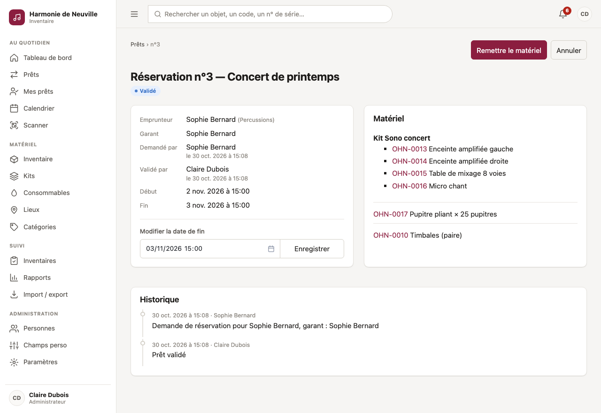

- Les objets passent « en garde » ou « sortis ». Leur état au départ est noté.
- Les consommables distribués sont retirés du stock et n'ont pas à être rendus.

### Vérifier qu'on n'a rien oublié

**Vérifier le matériel**, sur un prêt validé ou en cours (admins et profs) : typiquement en fin de concert, avant de quitter la salle, ou au départ du local.

- Scannez chaque objet avec la caméra du téléphone, une douchette, ou tapez son code. Le scan est continu : pas besoin de revenir en arrière entre deux objets.
- Scanner le QR d'un **kit** pointe tous les objets du kit. Pour un objet suivi **en quantité** (ex. 6 pupitres sous un seul QR), chaque scan compte un exemplaire ; **Tout compté** pointe la quantité entière d'un coup.
- Un QR abîmé ? **Pointer** coche l'objet à la main. **✕** retire un pointage.
- Un objet qui ne fait pas partie du prêt est signalé en rouge : il est peut-être à quelqu'un d'autre.
- La page affiche les **manquants** et les pointés (avec qui et à quelle heure). Quand tout est là, un bandeau vert l'indique.
- **Plusieurs personnes peuvent scanner en même temps** : la liste se met à jour toute seule.
- **Recommencer** efface le pointage. Il est aussi remis à zéro automatiquement à la remise du matériel : le pointage de préparation ne compte pas pour la fin du concert.

La vérification ne change rien au prêt : le retour au local s'enregistre toujours avec **Retour** (ci-dessous). Les consommables distribués et les éléments déjà rendus ne sont pas à pointer.

### Liste du matériel à imprimer

**Liste à imprimer**, sur la fiche d'un prêt (et sur la page de vérification) : une feuille A4 avec l'emprunteur, le garant, les dates et tout le matériel (contenu des kits détaillé, quantités, lieu de rangement), une case **Départ** et une case **Retour** par ligne, et des zones de signature. Un QR code en haut ouvre directement la page de vérification. L'emprunteur peut imprimer la liste de ses propres prêts (sans le QR).

### Récupérer le matériel

**Retour**, sur un prêt en cours : par un admin, ou par le prof garant.

- Cochez ce qui est rendu. Le **retour peut être partiel** : le reste demeure en cours.
- Pour chaque objet rendu, indiquez son état s'il a changé (usé, à réparer…). La fiche est mise à jour.
- Cochez **caution rendue** le cas échéant.
- Quand tout est rendu, le prêt passe « Rendu » et les objets redeviennent disponibles.

### Prolonger, raccourcir, annuler

- **Modifier la date de fin** (admins) : sur une demande, un prêt validé ou en cours. Une prolongation n'est acceptée que si le matériel reste libre.
- **Annuler** : sur une demande ou un prêt validé, pas encore remis. C'est possible pour un admin, pour la personne qui a fait la demande et pour le garant. Les autres personnes concernées sont notifiées.

**Mes prêts** liste les prêts dont vous êtes l'emprunteur et, pour les profs, ceux dont vous êtes garant.

## QR codes, étiquettes et scanner

Chaque objet et chaque kit a un **QR code unique**. Il contient l'adresse publique de l'appli suivie d'un identifiant secret, par exemple `https://inventaire.exemple.fr/q/3f9a…`.

- **Scanner avec l'appareil photo du téléphone** ouvre directement la fiche pour les admins et les profs connectés. Un emprunteur connecté voit une fiche réduite et ses éventuels prêts sur cet objet.
- **Sans compte**, n'importe qui (un parent, le gardien de la salle, une personne qui a trouvé l'instrument) voit une page publique : nom de l'association, nom et code de l'objet, et deux boutons, **Signaler un problème** et **J'ai trouvé cet objet**. Rien d'autre n'y apparaît (ni emplacement, ni valeur, ni n° de série, ni emprunteur). Un lien permet aux membres de se connecter pour voir la fiche complète. Voir [Signalements](#signalements).
- **Page Scanner** (admins et profs) : scan avec la caméra, ou saisie d'un code (`INV-0042`), ou lecture par une douchette USB.
- **Étiquettes** : depuis une fiche, un kit ou une sélection d'objets dans la liste. Trois formats de planches A4 adhésives (type Avery) sont proposés :
  - petit, 38 × 21 mm, 65 par page ;
  - moyen, 63,5 × 38 mm, 21 par page ;
  - grand, 99 × 68 mm, 8 par page.

  Un **décalage** permet de réutiliser une planche entamée. Il y a 500 étiquettes au maximum par impression.

> **Avant d'imprimer**, vérifiez que l'adresse publique (`BASE_URL`) est l'adresse définitive : elle est inscrite dans chaque QR code. L'appli prévient si elle vaut encore `localhost`.

La caméra du navigateur exige une connexion **HTTPS**, sauf sur `localhost`.

## Signalements

**Menu Signalements** (admins et profs, droit « Traiter les signalements »). Les messages laissés depuis la page d'un QR code arrivent ici :

- **Problème signalé** (« le tampon du sol fuit ») ou **Objet trouvé** (« oublié dans la salle des fêtes, déposé à l'accueil »), avec le nom et le contact laissés par la personne s'il y en a ;
- chaque message prévient par notification (et par email si le SMTP est configuré) les personnes qui traitent les signalements. Pour un objet trouvé, l'emprunteur et le garant d'un prêt en cours sont prévenus aussi ;
- une pastille dans le menu compte les signalements à traiter, et la fiche de l'objet ou du kit affiche un bandeau ;
- **Marquer comme traité**, avec une note facultative (« tampon changé »), le range dans l'onglet **Traités**. **Rouvrir** le remet à traiter. Pour un problème, un lien mène aux entretiens de l'objet.

Contre les abus, une même connexion peut envoyer 5 messages par heure, et un même objet en recevoir 10 par heure. Les signalements d'un objet mis à la corbeille ne s'affichent plus. Les textes des deux emails se modifient dans Paramètres → Emails.

## Inventaire physique

**Menu Inventaires**. Les admins et les profs scannent ; seuls les admins ouvrent, clôturent et suppriment un inventaire.

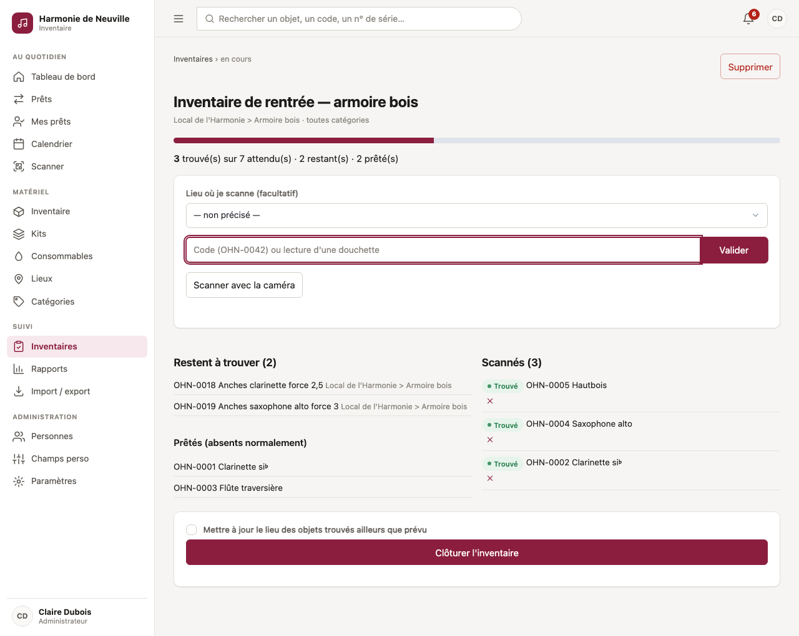

1. **Ouvrir un inventaire** : un nom, et un périmètre facultatif, par lieux (sous-lieux compris) et / ou par catégories. Sans périmètre, tout le parc est attendu, sauf les objets réformés.
2. **Scanner** ce qui est physiquement présent : caméra, douchette ou saisie du code. On peut préciser le lieu où l'on scanne. Chaque scan est classé :
   - **trouvé** : l'objet était attendu ;
   - **inattendu** : l'objet est hors du périmètre.
3. La page montre en direct ce qui **reste à trouver** et ce qui est **prêté**, donc absent normalement.
4. **Clôturer** : chaque objet attendu non scanné est enregistré **manquant**, ou **prêté** s'il est sorti. Les manquants sont notés dans leur historique. L'option **Mettre à jour le lieu** déplace les objets trouvés ailleurs que prévu vers le lieu où ils ont été scannés.

Le rapport clôturé est figé et exportable en CSV.

## Calendrier et abonnement iCal

**Menu Calendrier** (tout le monde).

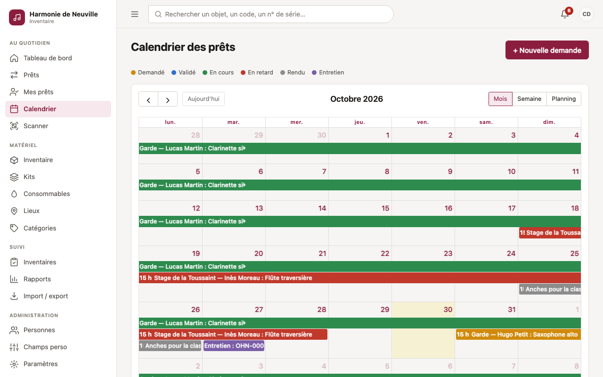

- Vues **mois**, **semaine** et **planning**. Les couleurs distinguent les prêts demandés, validés, en cours, en retard et rendus, ainsi que les entretiens.
- Un emprunteur ne voit que ses propres prêts.
- **Abonnement iCal** : le lien personnel affiché sur la page s'ajoute dans Google Agenda, Outlook ou Apple Calendrier. Il contient les prêts validés et en cours, de 3 mois en arrière à 1 an en avant.
  - Ce lien donne accès à vos prêts sans mot de passe : ne le partagez pas.
  - **Nouveau lien** invalide l'ancien.

## Notifications et rappels automatiques

La cloche en haut à droite indique les notifications non lues. Si un serveur SMTP est configuré, les notifications partent aussi par email.

Notifications liées aux actions :

- nouvelle demande de prêt (admins) ;
- prêt validé, refusé, annulé, ou date de fin modifiée (personnes concernées) ;
- stock passé sous le seuil (admins).

Rappels automatiques, calculés toutes les 15 minutes :

| Rappel | Destinataires | Fréquence |
|---|---|---|
| Rappel manuel arrivé à échéance | Destinataires choisis, sinon admins | Une fois |
| Entretien prévu dans les 7 jours ou dépassé | Admins | Une fois par échéance |
| Matériel à récupérer dans les 24 h | Emprunteur et garant | Une fois |
| Retour attendu dans les 24 h | Emprunteur et garant | Une fois |
| Prêt en retard | Emprunteur, garant et admins | Une fois par jour |
| Réservation validée jamais remise, 2 jours après le début | Admins | Une fois |
| Demande en attente depuis plus de 2 jours | Admins | Une fois par jour |
| Stock bas | Admins | Une fois par semaine |

## Rapports

**Menu Rapports** (admins et profs). Choisissez la période, puis imprimez la page (**Imprimer / PDF**) ou exportez chaque tableau en **CSV**.

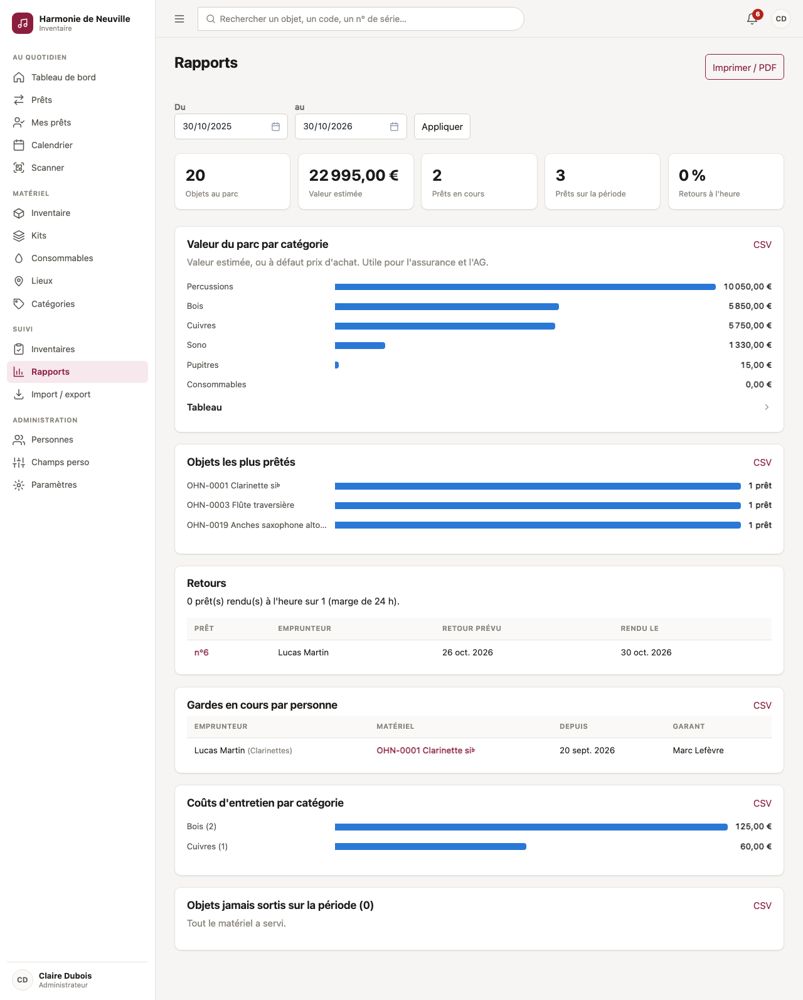

- **Indicateurs** : objets au parc, valeur estimée, prêts en cours, prêts sur la période, part des retours à l'heure.
- **Valeur du parc par catégorie** : valeur estimée, ou prix d'achat à défaut, hors objets réformés. Utile pour l'assurance et l'AG.
- **Objets les plus prêtés** sur la période.
- **Retours** : prêts rendus à l'heure ou en retard, avec une marge de 24 h.
- **Gardes en cours par personne**.
- **Coûts d'entretien par catégorie**.
- **Objets jamais sortis** sur la période.

## Import et export

**Menu Import / export**.

- **Export** (admins et profs) : tout l'inventaire, ou le résultat d'un filtre, en **Excel** ou en **CSV**. Les champs personnalisés sont inclus. Le CSV utilise le point-virgule comme séparateur et s'ouvre directement dans Excel.
- **Import** (admins) : un fichier `.xlsx` ou `.csv`, une ligne par objet, avec une ligne d'en-têtes, 5 000 lignes au maximum.
  1. L'appli **devine l'association des colonnes** d'après leurs en-têtes : « Désignation », « Instrument », « N° de série », « Emplacement »… Vérifiez-la et corrigez-la si besoin.
  2. Les options :
     - catégorie par défaut ;
     - création automatique des catégories et des lieux manquants (un lieu peut s'écrire « Local > Armoire bois ») ;
     - mise à jour des objets existants (repérés par leur code).
  3. **Faire un essai** : l'import est simulé, puis annulé. Vous voyez combien d'objets seraient créés ou mis à jour, et les erreurs ligne par ligne.
  4. **Importer** pour de bon.

Les lignes en erreur sont ignorées, les autres importées. Les dates (`15/03/2024`, `2024-03-15`) et les montants (`1 150,00 €`) sont reconnus sous leurs formes courantes.

## Personnes et comptes

**Menu Personnes**.

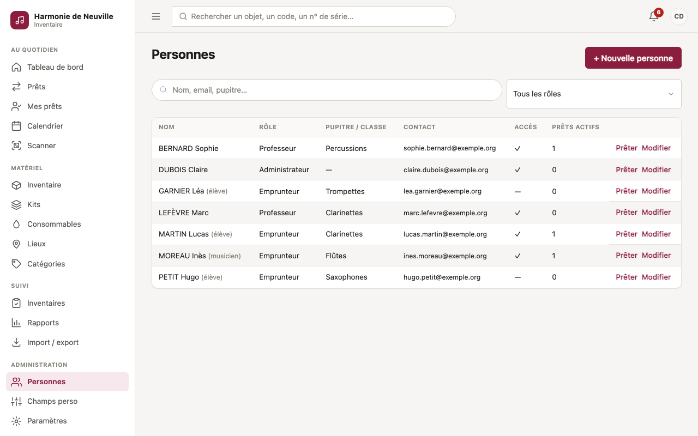

- **Les profs** peuvent créer des **fiches emprunteur**, sans accès à l'appli, pour pouvoir leur prêter du matériel.
- La liste montre le **statut** de chaque personne (actif, jamais connecté, invitation en attente, sans accès, archivé) et sa **dernière connexion**. Un filtre par statut complète le filtre par rôle ; les fiches archivées n'apparaissent qu'avec le filtre « Archivé ».
- Un clic sur un nom ouvre la **fiche détaillée** : coordonnées, accès, prêts en cours et passés, prêts dont la personne est garante. Les gestionnaires de comptes y voient aussi les **appareils connectés** (avec déconnexion un par un ou tous d'un coup) et le **journal** des actions faites par la personne ou la concernant.
- **Les admins** créent et modifient tous les comptes :
  - **Rôle** : administrateur, professeur, emprunteur ou un [rôle sur mesure](#rôles-sur-mesure).
  - **Peut se connecter** : ouvre l'accès, ce qui demande un email. L'appli envoie une **invitation** : un lien valable 7 jours pour choisir son mot de passe. Sans email configuré (ou si l'envoi échoue), le lien s'affiche **une seule fois** pour que vous le transmettiez.
  - Depuis la fiche : **Renvoyer l'invitation** (ou **Envoyer un lien de réinitialisation** si la personne a déjà un mot de passe), et **Mot de passe provisoire** en dernier recours, à transmettre de vive voix. Un nouveau lien annule le précédent.
  - Décocher **Peut se connecter** coupe l'accès immédiatement, y compris pour une personne déjà connectée, et annule les liens en attente. L'historique et les prêts sont conservés.
- **Actions groupées** : cochez des personnes dans la liste, puis **Ouvrir l'accès** (avec invitation par email), **Couper l'accès**, **Archiver** ou **Changer le rôle**. Les personnes qui ne s'y prêtent pas (sans email, avec des prêts en cours, votre propre compte…) sont ignorées et listées.
- **Gestion de la fiche** (en bas de la fiche détaillée) :
  - **Archiver** : pour une personne qui quitte l'association. Elle perd son accès et disparaît des listes et des choix (emprunteur, garant), mais tout son historique reste. Impossible tant qu'elle a des prêts en cours ou à venir, comme emprunteuse ou garante. **Sortir des archives** la remet dans les listes, sans accès.
  - **Supprimer** : seulement pour une fiche sans aucun historique (créée par erreur, par exemple).
  - **Fusionner** : deux fiches pour la même personne (créée deux fois, ou fiche emprunteur puis compte). La fiche choisie est conservée et récupère les prêts, notes, entretiens, notifications et le journal de l'autre, ainsi que l'email, le téléphone, le pupitre ou la photo qui lui manquent. L'appli propose les doublons probables (même nom, email ou téléphone).
- Un admin ne peut pas retirer ses propres droits d'administrateur, pour éviter de se retrouver sans aucun admin.
- Seul un admin peut donner ou retirer le rôle d'administrateur, ou modifier, archiver ou réinitialiser le compte d'un admin.

Avec la connexion OIDC et des groupes configurés, les rôles peuvent aussi venir du fournisseur d'identité : voir [Rôles d'après les groupes](oidc-authentik.md#rôles-daprès-les-groupes).

## Rôles sur mesure

**Menu Rôles** (admins). La liste montre chaque rôle, son nombre de droits, ses groupes OIDC et le nombre de personnes qui l'ont.

- **Nouveau rôle** : un nom (« Régisseur », « Secrétariat »…), une description facultative, puis les droits à cocher, regroupés par thème (inventaire, prêts, inventaires et rapports, administration).
- **Dupliquer** part des droits d'un rôle existant : pratique pour créer « Prof principal » à partir de Professeur.
- **Modifier** : on peut aussi renommer les rôles de base et changer les droits du Professeur et de l'Emprunteur. L'**Administrateur** garde toujours tous les droits.
- **Supprimer** : seulement pour un rôle sur mesure que plus personne n'a. Les rôles de base ne se suppriment pas.
- **Groupes OIDC** : les membres de ces groupes reçoivent le rôle à la connexion (voir [Rôles d'après les groupes](oidc-authentik.md#rôles-daprès-les-groupes)).

Quelques droits ont un effet particulier :

- **Être garant** : la personne apparaît dans la liste des garants, voit « Prêts dont je suis garant » et remet ou récupère le matériel des prêts dont elle est garante ;
- **Ajouter des notes** et **Enregistrer des entretiens** permettent de supprimer les siens ; « … des autres » permet de supprimer ceux de tout le monde ;
- **Gérer les comptes** donne accès à la modification des personnes, mais pas aux comptes administrateurs ni à l'écran Rôles, réservés aux admins.

Un changement de droits s'applique immédiatement, y compris aux personnes déjà connectées.

## Paramètres

**Menu Paramètres** (admins). La page affiche la configuration en cours : nom de l'association, adresse publique, préfixe des codes, état des emails. Elle propose ces actions :

- **État de l'installation**, qui vérifie la base de données, les migrations, l'espace disque, le passage des rappels automatiques et les emails (voir [Installation](installation.md#journaux-et-diagnostic)) ;
- **M'envoyer un email de test**, pour vérifier la configuration SMTP ;
- **Lancer les rappels maintenant**, sans attendre le prochain passage automatique.

Ces réglages se modifient dans le fichier de configuration du serveur : voir [Configuration](configuration.md).

## Installer l'appli sur un téléphone

L'inventaire s'installe comme une application, avec une icône sur l'écran d'accueil et un affichage plein écran :

- **iPhone (Safari)** : bouton Partager, puis **Sur l'écran d'accueil** ;
- **Android (Chrome)** : menu ⋮, puis **Installer l'application** ou **Ajouter à l'écran d'accueil**.

Sur téléphone, une barre d'onglets en bas d'écran donne accès à l'accueil, aux prêts, au scanner et au matériel.

## Qui peut faire quoi

Droits par défaut des rôles de base (modifiables dans l'écran [Rôles](#rôles-sur-mesure)).

| Action | Admin | Prof | Emprunteur |
|---|:---:|:---:|:---:|
| Voir l'inventaire, les kits, les lieux | ✅ | ✅ | — |
| Créer et modifier objets, kits, lieux, catégories, photos, tags | ✅ | ✅ | — |
| Voir, ajouter et supprimer les documents joints (factures, notices…) | ✅ | ✅ | — |
| Réformer ou supprimer un objet ; supprimer un kit, un lieu, une catégorie ; restaurer depuis la corbeille | ✅ | — | — |
| Ajouter une note | ✅ | ✅ | — |
| Supprimer une note | ✅ | ses notes | — |
| Enregistrer un entretien, un rappel | ✅ | ✅ | — |
| Supprimer un entretien | ✅ | ceux qu'il a saisis | — |
| Mouvements de stock | ✅ | ✅ | — |
| Champs personnalisés | ✅ | — | — |
| Créer une fiche emprunteur (sans accès) | ✅ | ✅ | — |
| Gérer les comptes et les accès | ✅ | — | — |
| Créer et modifier les rôles | ✅ (toujours) | — | — |
| Demander un prêt | ✅ | ✅ (garant) | pour lui-même, avec un garant |
| Accepter ou refuser d'être garant d'une demande d'emprunteur | — | s'il a été choisi | — |
| Voir tous les prêts | ✅ | ✅ | ses prêts |
| Valider ou refuser un prêt, modifier sa date de fin | ✅ | — | — |
| Remettre et récupérer le matériel | ✅ | s'il est garant | — |
| Vérifier le matériel d'un prêt (scan « rien oublié ») | ✅ | ✅ | — |
| Imprimer la liste du matériel d'un prêt | ✅ | ✅ | ses prêts |
| Annuler un prêt (avant la remise) | ✅ | s'il l'a demandé ou en est garant | — |
| Scanner, imprimer des étiquettes | ✅ | ✅ | — |
| Traiter les signalements reçus par QR code | ✅ | ✅ | — |
| Signaler un problème ou un objet trouvé depuis un QR code | ✅ | ✅ | ✅ (et sans compte) |
| Scanner pendant un inventaire physique | ✅ | ✅ | — |
| Ouvrir, clôturer, supprimer un inventaire physique | ✅ | — | — |
| Rapports et export | ✅ | ✅ | — |
| Import | ✅ | — | — |
| Paramètres | ✅ | — | — |
| Mes prêts, calendrier, notifications | ✅ | ✅ | ✅ |

## Questions fréquentes

**Deux profs ont demandé le même instrument pour la même date. Que se passe-t-il ?**
Les deux demandes sont enregistrées, avec un avertissement. L'admin valide l'une ; l'autre ne pourra plus être validée sur cette période.

**Un élève rend son instrument abîmé.**
Au retour, indiquez le nouvel état (« à réparer »). Ensuite, enregistrez un entretien en mettant l'objet « en entretien » pour qu'il ne soit plus prêté.

**On a perdu un objet.**
Un admin le **réforme** : il sort du parc et des rapports de valeur, mais son historique reste consultable.

**L'élève ne se connectera jamais à l'appli.**
Une **fiche emprunteur** sans accès suffit pour lui prêter du matériel.

**Les QR codes imprimés mènent à une mauvaise adresse.**
L'adresse publique a changé après l'impression. Remettez l'ancienne adresse en redirection sur le reverse proxy, ou réimprimez les étiquettes.

**Je ne reçois pas les emails.**
Un admin peut tester l'envoi dans **Paramètres**. Sans serveur SMTP configuré, les notifications restent dans l'appli.
